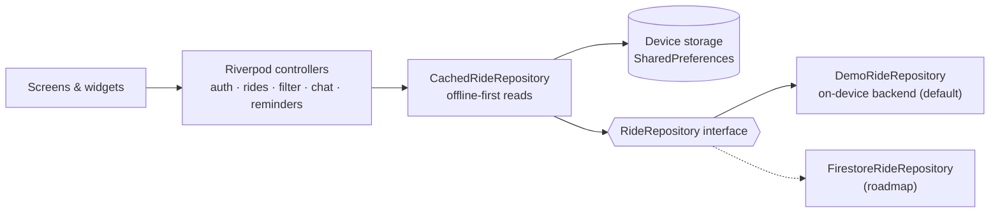

<h1 align="center">🚗 Raider Rides</h1>

<p align="center">
  A ride-share board for Texas Tech students: post a trip, split the gas, and chat before you go.
</p>

<p align="center">
  <a href="https://chiru-6.github.io/raider-rides/"></a>
  
  
  
  
</p>

---

Every break, the TTU group chats fill up with "anyone driving to Dallas Friday?". Raider Rides turns that into a
proper board. Drivers post a trip with seats and a total cost, riders find one by destination and day, and everyone
sees exactly what they'll pay as the car fills up.

## ✨ Features

- **Post a ride.** Pickup, destination (with one-tap popular picks), date, time, seats and total trip cost, with a live per-person split preview.
- **Find a ride.** Search by city, filter by day, by seats needed, or show only rides you drive or joined. Past and full rides are hidden.
- **Fair cost split.** The total is split across everyone in the car, driver included. The price shown when you join is what you'd actually pay, and it drops as more riders join.
- **Join or leave in one tap.** Seat counts update right away, and joining a full ride is blocked.
- **In-ride chat.** Ask about luggage or pickup spots. In demo mode, the sample drivers reply.
- **Departure reminders.** Scheduled one hour before every ride you're in, shown as a banner and kept in a reminders inbox.
- **Offline-first.** Every ride list you load is saved on the device. With no connection, the app shows saved rides with a "last synced" banner instead of an error. You can test this with the *Simulate offline mode* switch.
- **TTU-only sign-in.** Only `@ttu.edu` emails are accepted.
- **Light and dark themes** in Texas Tech scarlet, using Material 3.

## 📸 Screenshots

<!-- Run the app, take screenshots, save them in docs/screenshots/ and uncomment:
<p align="center">
  
  
  
  
</p>
-->

*Coming soon. Meanwhile, try the [live web demo](https://chiru-6.github.io/raider-rides/).*

## 🏗️ Architecture



- **The `RideRepository` interface** is the only thing the app knows about the backend. The demo backend runs on the device, adds realistic latency, and persists its data, so the app runs with zero setup. A Firestore implementation slots in behind the same interface.
- **`CachedRideRepository`** wraps any backend. Successful reads are saved, failed reads fall back to the saved copy, and writes clearly fail when offline.
- **Riverpod** controllers hold app state. Filtering is a pure function (`applyFilter`) that's unit-tested separately from the UI.
- **The clock and storage can be swapped in**, so the logic is tested with a fixed "now" and in-memory storage.

```
lib/
├── core/        theme, date formatting, validators
├── models/      Ride, ChatMessage, Reminder, AppUser
├── data/        repository interface, demo backend, offline cache, seed data
├── state/       Riverpod providers and controllers
└── ui/          screens and widgets
test/            unit tests (models, filters, cache, validators) and widget tests
```

## 🚀 Getting started

Requires the [Flutter SDK](https://docs.flutter.dev/get-started/install) (stable channel, Dart 3.5+).

```bash
git clone https://github.com/chiru-6/raider-rides.git
cd raider-rides

# First time only: generate the platform folders (your lib/ and test/ files are left untouched)
flutter create . --platforms=android,ios,web --project-name raider_rides

flutter pub get
flutter run            # pick an emulator, a phone, or Chrome
```

Run the checks:

```bash
flutter analyze
flutter test
```

Sign in with any name and an `@ttu.edu` email. Sample rides load automatically. Open **Profile** to simulate offline
mode or reset the demo data.

## 🌐 Live demo

Every push to `main` builds the web version and publishes it to GitHub Pages (`.github/workflows/deploy-web.yml`).
One-time setup: **Settings → Pages → Source: GitHub Actions**.

## 🗺️ Roadmap

- [ ] Firebase Auth with email-link sign-in, restricted to `@ttu.edu`
- [ ] `FirestoreRideRepository` with live snapshot streams for rides and chat
- [ ] Push reminders with Firebase Cloud Messaging and a scheduled Cloud Function
- [ ] Ride requests that the driver approves, plus rider ratings
- [ ] Map preview of pickup spots

## 📄 License

MIT © 2026 Chirandan Raaman Murugan. A student project, not affiliated with Texas Tech University.
